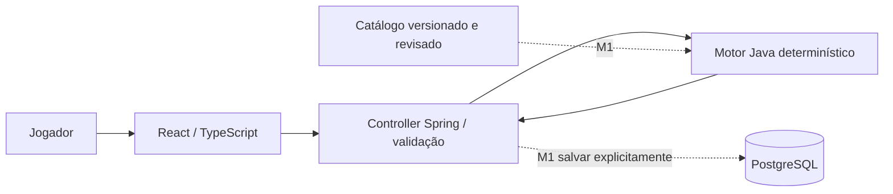

# Arquitetura e modelo de dados

## ADR-001 — monólito modular
React + TypeScript (Vite) → HTTP JSON → Spring Boot → motor Java puro. PostgreSQL via JDBC/Flyway no perfil postgres. Um repositório, dois aplicativos; sem Redis, filas ou microsserviços. O motor recebe estado + objetivo + ruleset e retorna um valor imutável. Nenhum LLM, chamada HTTP, relógio ou consulta ao banco dentro do algoritmo.

## ADR-002 — contrato antes da implementação
`openapi.yaml` especifica M0. O contrato textual foi criado antes de delegar backend e frontend. Mudança de semântica exige atualizar spec, exemplos, consumidor e teste no mesmo incremento. Erro de entrada: 400 JSON com code/message. Objetivo impossível: 200 com diagnóstico de domínio. Falha inesperada: 500 sem dados internos. Em M1 adicionar códigos estruturados por regra e parâmetros de explicação; não usar texto localizado como identificador.

## ADR-003 — versionamento e dados
Ruleset tem ID imutável, versão, status e origem. Versão de engine deve ser registrada junto a snapshots em M1; mudar ordem/prioridade também muda engineVersion. Não prometer reprodutibilidade de plano persistido sem registrar ambos. M0 é stateless, não salva requests automaticamente. Banco não é necessário para calcular.

## Estrutura física preparada em V1
| Tabela | Campos principais | Relação / intenção |
|---|---|---|
| rule_set | id, version, status, source_url | Identidade do conjunto de regras |
| saved_build | id UUID, name, ruleset_id, character_state JSONB, created_at | N builds pertencem a um ruleset |
| plan_snapshot | id UUID, build_id, ruleset_id, request JSONB, response JSONB, created_at | N planos por build; inputs/outputs históricos |

A migration SQL no backend é a definição executável dos nomes/tipos/constraints. JSONB evita migrações de coluna a cada alteração do snapshot, mas validação de conteúdo continua no domínio. SQL deve assegurar FK e tipos estruturais. Consultas futuras por atributo podem justificar índices/normalização; não antecipar.

## Modelo lógico de M1 (ainda não migrado)
- `RuleEvidence(id, rulesetId, ruleId, sourceUrl, sourceDate, checkedAt, patch, platform, status, fixturePath, reviewer)`.
- `PerkDefinition(rulesetId, perkId, attribute, minAttribute, maxRank, dlc)` e `PerkRank(rulesetId, perkId, rank, cost, evidenceId)`.
- `PerkRequirement(rulesetId, perkId, rank, requiredPerkId, requiredRank)`; chaves compostas mantêm todo o grafo na mesma versão.
- `BuildState`: nível, DLC, cinco atributos, saldo, perks/ranks, total de pontos extras conhecidos, reset disponível. Nunca deduzir pontos extras só do nível.
- `GoalTemplate`: ID, ruleset, revisão editorial, mínimos, perks alvo, prioridades e limites de cobertura.
- `PlanSnapshot`: adicionar engineVersion, schemaVersion e catálogo exato; snapshots imutáveis. Salvar construção atual separadamente do estado simulado final.
- `SavedBuild`: adicionar version para controle otimista se edições forem introduzidas. Sem identidade/autenticação, uso local apenas.

## Contratos previstos para M1, ainda não disponíveis
GET `/api/v1/rulesets` e GET `/api/v1/rulesets/{id}/perks`: somente catálogos validados ou flag experimental explícita. POST `/api/v1/builds`: salvar estado validado, 201 com Location. GET `/api/v1/builds/{id}`: 200/404. POST `/api/v1/builds/{id}/plans`: salvar snapshot após calcular, 201; nunca sobrescrever versão anterior. Revisar esquema OpenAPI antes de implementar; estes caminhos são proposta, não API executável.

## ADR-004 — limites de execução
Serviços de desenvolvimento ligados em loopback. PostgreSQL contém somente dados locais de teste e usa senha de desenvolvimento declarada no Compose. Nenhum segredo de produção. Sem exposição pública até definir identidade, limites de tamanho/rate, autorização de builds e políticas operacionais. CORS amplo não é necessário: Vite faz proxy da API em desenvolvimento; em implantação futura usar mesma origem.

## ADR-005 — infraestrutura mínima e atualização
Java21 é baseline de compilação; Maven gerencia dependências. Node24 é o ambiente encontrado. Dependências frontend travadas por lockfile; Spring Boot parent fixa o conjunto Java. Fixar versão major do PostgreSQL no Compose; fixar digest após homologar deployment. Perfil postgres ativa migration; não confundir health de processo com prontidão do banco. Persistência e teste PostgreSQL real são tarefa separada.
